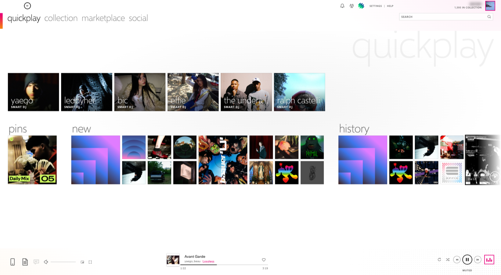
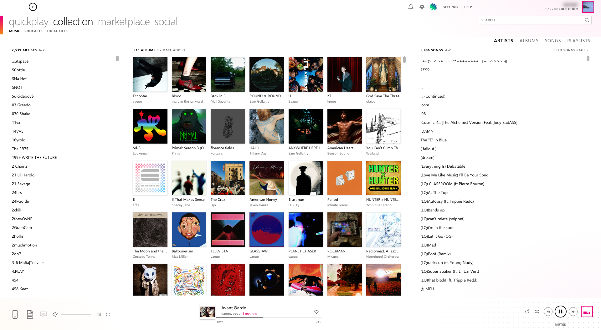
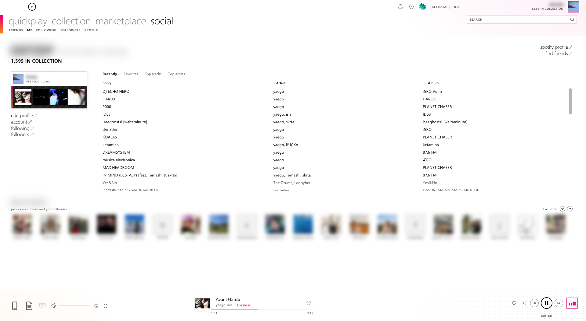
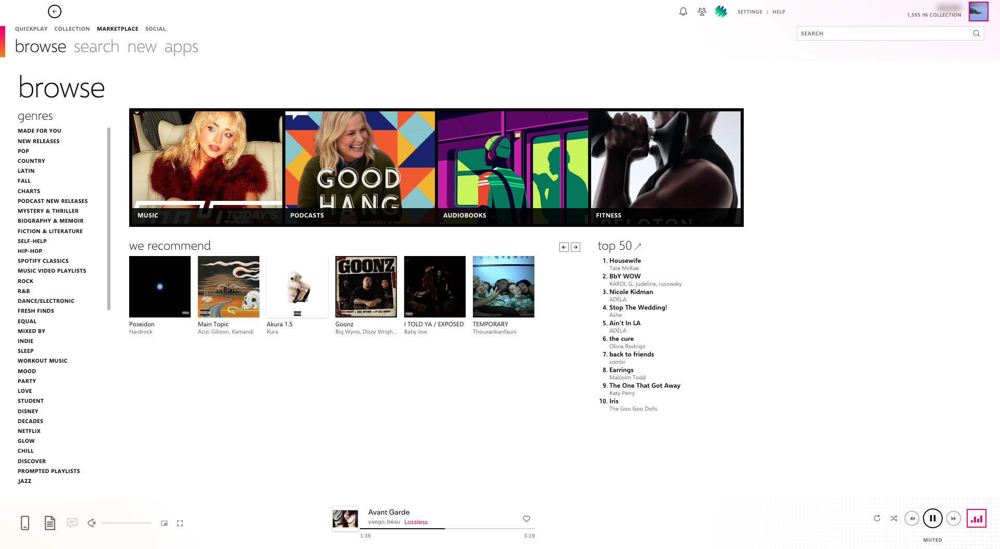
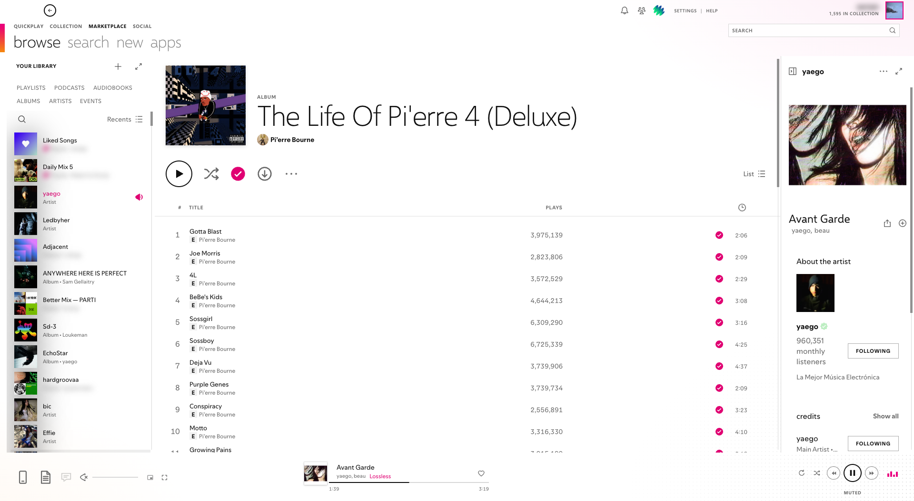
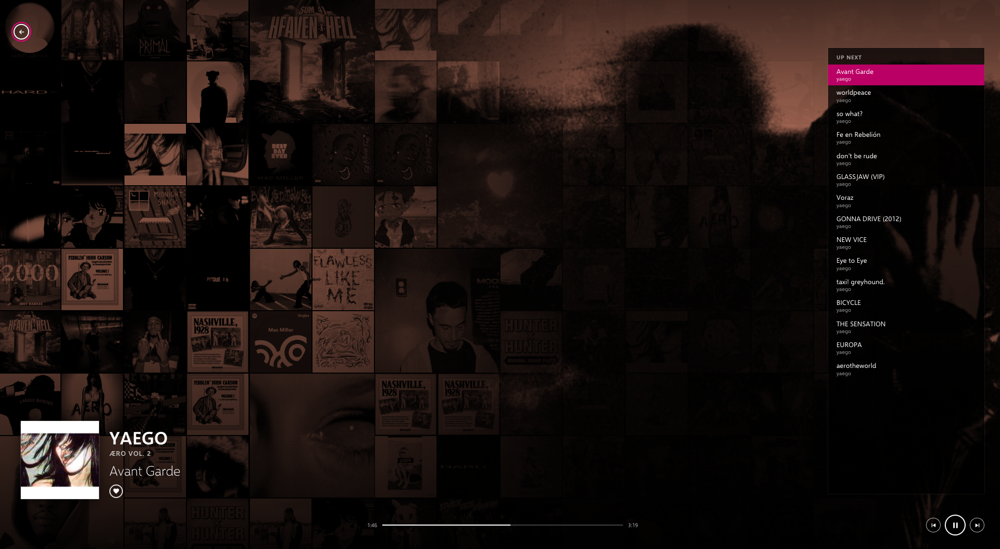
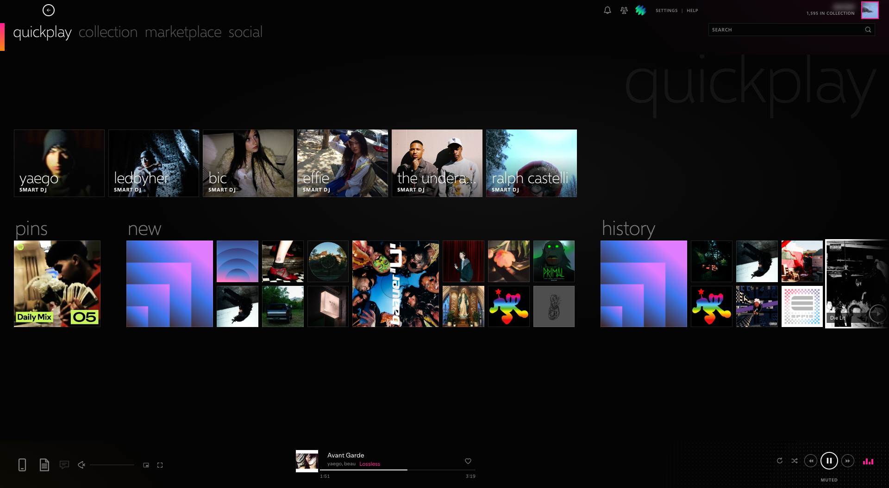
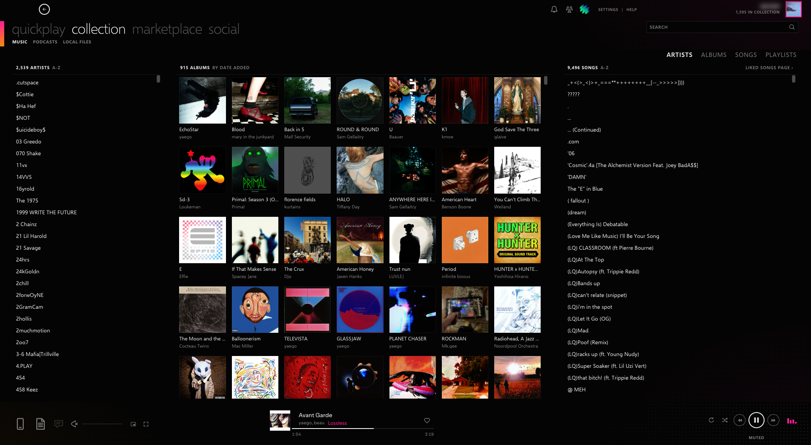
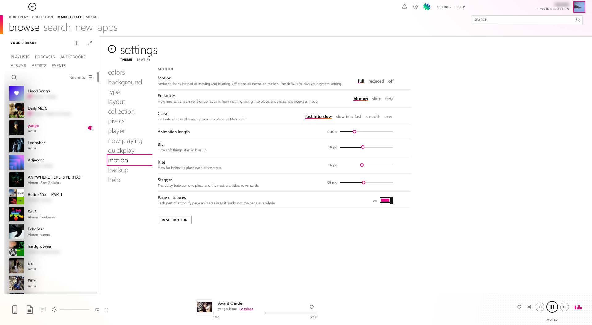

# Zoone

A Spotify theme for [Spicetify](https://spicetify.app) after the Zune 4 desktop software (2009–2011): lowercase pivot navigation, a magenta-to-orange accent, flat square album art, outlined round transport buttons, Zune's Quickplay and Social pages, a three-column collection view, a full-window mix view with a flipping album-art wall, and blur-up motion. Light and dark, switchable from its own settings page.



Zoone is a fan theme and is not affiliated with Microsoft. Zune is a trademark of Microsoft Corporation. No Microsoft artwork, logos or icon files are included; the icons are original drawings in Zune's style.

Tested on Spotify 1.3.6 (macOS) with Spicetify 2.46.

## Install

**Spicetify Marketplace:** open Marketplace, go to **themes**, find **Zoone**, and click **Install**. Pick the light or dark scheme on the card. Zoone's JavaScript (pivots, Quickplay, Social, the collection view, the mix view and the settings page) is loaded with it.

**By hand:** copy this folder to your Spicetify `Themes` folder as `Zoone` (`~/.config/spicetify/Themes/Zoone` on macOS and Linux, `%appdata%\spicetify\Themes\Zoone` on Windows), then run:

```sh
spicetify config current_theme Zoone color_scheme light inject_theme_js 1
spicetify apply
```

The folder needs `user.css`, `color.ini` and `theme.js`. The theme does little without `theme.js`, so keep `inject_theme_js` on.

## Screenshots

| | |
| --- | --- |
|  |  |
|  |  |
|  |  |
|  |  |
|  | |

## Color schemes

| Scheme  | Look |
| ------- | ---- |
| `light` | Zune 4 default: white canvas, charcoal type, magenta accent. |
| `dark`  | Black everywhere, like Quickplay and Now Playing. |

Pick one in **Settings > colors > Theme**: light, dark, or match system (follows macOS). It applies to every page and switches without a restart. `build.mjs` ships both schemes from `color.ini` in `user.css`, so the one Spicetify didn't apply is there too. With a manual install, `spicetify config color_scheme dark` followed by `spicetify apply` sets the starting scheme; with Marketplace, pick it on the theme's card. Each scheme keeps its own colour changes. Colors live in `color.ini`. Besides Spotify's standard keys, the theme adds `zune-accent` (magenta), `zune-accent-2` (the orange that the corner stripe and accent lines fade to), `zune-pivot`, `zune-line`, and `qp-*` (colors for the black Quickplay screen).

## What changes

| Zune | In Spotify |
| ---- | ---------- |
| `quickplay collection marketplace social` pivots | The Zune Quickplay page, the Zune collection view, Search/Browse, and the Zune social "me" page. The pivot follows the page you are on. |
| Quickplay | A start screen at `/zune/quickplay` in place of Spotify's Home, laid out like Zune 4.0's: a giant faint "quickplay", one row of big **smart dj** tiles (your most recently played artists; a click starts the artist's Spotify radio, falling back to the artist if Spotify doesn't answer; with [Better Mix](#better-mix-smart-dj) installed, it can play a Better Mix version of that radio), and below it a quieter strip of **pins**, **new** (recently added) and **history** (recently played), each a mosaic of covers under a big light title. Both rows scroll sideways with the mouse wheel and fade at the edge that has more. Hover shows Zune's two rings, play and open. |
| Social > me | Your profile at `/zune/social`: name in bold caps, a profile card with a strip of recent covers, tabs (recently, favorites, top tracks, top artists) over Song / Artist / Album columns (double-click plays, the playing song is in the accent colour), and a paged row of friends (people you follow, then your followers). |
| Marketplace pages | Browse is laid out like Zune's marketplace: a big "browse" title, the genres as a small-caps list on the left, four featured tiles with a caption band, **we recommend** (new releases from artists you follow, with paging), and the numbered **top 50** chart. The Spicetify Marketplace (apps) shows each theme or extension as a picture tile with a caption band. |
| Sub-pivots (`MUSIC PODCASTS …`) | collection: music, podcasts, local files. marketplace: browse, search, new, apps (the Spicetify Marketplace, if installed). social: friends, me, following, followers, profile (Spotify's profile page). |
| Marketplace's big sub-pivot row | In marketplace the main pivots shrink to small caps and the sub-pivots become the big row, as in Zune. |
| Back circle, `SETTINGS \| HELP`, user name and square avatar tile | Spotify's back button, the theme's settings page, a help list, and Spotify's account menu. The name sits flush against the avatar tile, as in Zune; Spotify's bell, friends and extension icons sit before `SETTINGS \| HELP`. |
| Collection: `ARTISTS ALBUMS SONGS PLAYLISTS` and the columns under it | A collection view at `/zune/collection` that fills the window under the header. ARTISTS has three columns: every artist you have music by (A-Z), their saved albums (by date added), and the songs, which are your liked songs by that artist or the selected album's tracklist. ALBUMS is the album grid with its songs, SONGS is all liked songs in a list with artist, album and length, and PLAYLISTS is your playlists and the selected one's songs. Click selects, double-click or Enter plays, and the arrow keys move. Each column header links to Spotify's full page. The **filter** box at the top left (Cmd+F, Ctrl+F on Windows) narrows every list to names, artists, albums or owners containing all the words you type; Esc clears it. Albums sort by date added, a-z, artist or recently played, and playlists by a-z, date added or recently played. In SONGS, the column headings sort (again to reverse), and the sort choice also offers date added. Sort orders are remembered. |
| Library filter chips | Spotify's library sidebar keeps its filters, shown as an uppercase switcher. |
| Device, disc, and playlist glyphs at the bottom left | Spotify's devices, queue and lyrics buttons first and large, drawn as thin Zune-style icons (a phone for devices, a playlist sheet for the queue), then volume, then a small mini player and full screen. The player's previous and next are double triangles, repeat is a circular arrow, and the like button is a heart. Clicking a filled heart takes the song out of Liked Songs at once, as in Zune (Option-click, Alt-click on Windows, opens Spotify's playlist picker; Settings > player can turn this off). The icons are drawn for this theme in Zune's style; they are not Microsoft's files. The Zune icons for Spotify's own download, shuffle, create and expand buttons need Spotify's English interface; in other languages those buttons keep Spotify's icons. |
| Track art, title, and a hairline progress bar | Spotify's now-playing widget and seek bar: elapsed time under the left end of the line, the length under the right end, and the heart above the right end. In the light theme a Canvas video plays inside its own box, so the now playing panel stays light. |
| Repeat and shuffle (magenta when on), prev / **play** / next rings, `VOLUME 49` | Scroll over `VOLUME` to change the volume. Click it for a slider and a mute toggle. |
| Pink equalizer bars, or the album art in the player bar | Open the mix view: a tinted, flipping mosaic of your albums and related artists, artist photos, the queue, and transport controls. In its up next list, double-click a song or press Enter to play from there; songs you queued have a remove button, and Delete removes them too. Press Esc or the back circle to leave. While it is open, the rest of the app is inert and keyboard focus stays inside it. It also opens by itself after 5 minutes without input, like Zune. |
| Metro motion | Each piece of a new page (header art and title, the play row, track rows, cards, section titles) blurs up from nothing into its place as Spotify renders it, 0.4 s, fast into slow, the first few one after another. Theme screens (settings, collection columns, sub-pivots, the mix view and its album wall, Quickplay, Social, Browse) enter the same way, and the cover and title blur up when the song changes. Zune's sideways slide is still available. |
| Names and right-click menus | On Zoone's pages (Quickplay, collection, social, browse and now playing), each artist and album name is a link to its page. Right-click a song, album, artist or playlist, or press Shift+F10 or the menu key, for a Zune-style menu: play, play next, add to now playing, add to playlist, go to album or artist, add to collection or follow, pin to quickplay, start smart DJ, copy link. It only offers what fits: pin appears for things in your library, follow becomes unfollow. Esc closes the playlist list first, then the menu. Spotify's own pages keep Spotify's menu. |
| Keyboard | Type the first letters of a name in a collection list or a menu to jump to it. The arrow keys move between Quickplay's tiles and between the social tabs. Enter on a social or top 50 song plays it, and Enter on a name opens its page. |
| Long titles | Titles in the player bar end with an ellipsis instead of running under the like button; the now playing panel wraps them to two lines. The library's filter chips wrap instead of scrolling under an arrow. |

## Options

Click **SETTINGS** in the top bar, or **Zoone settings** in the profile menu. The settings page covers the content area and leaves the header, sidebar, and player bar visible, so changes show up as you make them. Its **spotify** tab opens Spotify's own settings. **HELP** opens a short list of tips; Esc closes it.

There are 107 settings in 11 categories; one of them appears only when Better Mix is installed. Changes apply at once, without a reload or `spicetify apply`. Pivot labels and the custom font update as you type. The background picture applies when you press Enter or leave the field, and the row reports whether the picture loaded.

| Category | What you can change |
| -------- | ------------------- |
| colors | Theme (light, dark, or match system); accent (with the Windows Phone accent palette); accent lines, which have their own color, follow Accent until you pick one, and draw the corner stripe, tab underlines, focus borders and the progress line on hover; gradient end; line style (Zune gradient or one color); inactive pivots; hairlines; Quickplay grey; high contrast |
| background | Background picture and its wash, corner glow, halftone dots and their strength, corner stripe and its width, square corners, flat page headers (also hides genre and artist banners) |
| type | Font (Segoe UI or bundled Selawik, Selawik, Spotify's, or any installed font), lowercase section titles, section title size, pivot weight |
| layout | Full-window Quickplay, Social and Browse pages (on by default), compact or large page headers, track row height, search box width, scrollbars always visible or auto-hide, horizontal scrollbars |
| collection | The Zune collection view on or off, everyone in your collection or only artists you follow in ARTISTS, the view it opens on, full width or main view only, row height, album size |
| pivots | Pivot size, sub-pivots, big sub-pivots in marketplace, what collection opens, Zune's social me page or Spotify's profile, Zune's browse page or Spotify's, SETTINGS / HELP links, user name, custom app icons, and the four pivot labels |
| menus | Right-click menus on or off, and each item they offer: play, play next, add to now playing, add to playlist, go to album, go to artist, add to collection (follow, for an artist), pin to quickplay, start smart DJ, copy link |
| player | Zune icons, heart removes a like, volume control (readout, Spotify's slider, or both), scroll-to-change and step, now playing button, album art opens now playing (on by default), quality badge, bar height, and each left-tray button |
| now playing | Tile flipping and interval, tile size, colour or greyscale mosaic, tint source and strength, custom tint, picture sources (library, queue, related artists), artist photos and interval, up-next list and length, the "now playing" title, and when it opens by itself: after 1 to 30 minutes without input (default 5), only while music plays, and whether any input closes it again |
| quickplay | Zune's Quickplay page or Spotify's Home, the number of smart dj tiles, Better Mix smart dj (only shown when Better Mix is installed), tile size, black Quickplay (light theme only, off by default), whole window or main view only, giant section titles |
| motion | Full, reduced (fades only), or off; entrances (blur up, slide, fade); curve (fast into slow, the default, as Metro settled things into place; slow into fast; smooth; even); animation length; blur; rise; stagger; page entrances on or off. The default motion follows the system's reduced-motion setting. |

### Better Mix smart dj

If the Better Mix extension is installed, **Settings > quickplay > Better Mix smart dj** appears (off by default). With it on, a smart dj tile still starts the artist's Spotify radio at once, and Better Mix builds its own version of that radio meanwhile (a few seconds to about 20; a mix built that day comes back at once). From the next song on, the Better Mix songs play. Smart dj keeps only the next two in the queue, so anything you queue plays within a song or two. The tile caption says what it's doing: **building…**, **better mix next**, **better mix**, or **radio** when Better Mix is busy with its own builds and the radio just plays on. Away from Quickplay, a notice says the same. If you start something else, smart dj takes its waiting songs back out of the queue; songs you queued stay. After the mix, smart dj plays the rest of that radio itself, leaving out every song the mix already played (by entry, or by title and artist) and the radio songs you heard while it built, so nothing comes round twice; the tile then says **radio**. These mixes don't appear in Better Mix's Home row, though Better Mix's own page lists them, so you can save one as a playlist.

Each row has a **default** button, and colours have a **scheme** button that returns them to `color.ini`. Each category has its own reset. Colour changes are stored separately for the light and dark schemes.

The **backup** category exports your changed settings as JSON and imports them on another computer. An import is checked before anything changes. A file that isn't a version 2 Zune export, has an unknown key or scheme, or has an out-of-range value is rejected, and the message names the problem. Backup can also copy your current colours as a `color.ini` scheme section, and it has a reset-everything button.

Settings are stored in Spotify's local storage under `zune:settings`. Only values that differ from the defaults are saved, so new defaults reach you when the theme updates.

## Building

`user.css` is generated. Edit `src/zoone.css`, `color.ini` or `theme.js`, then run (Node.js 18 or newer):

```sh
node build.mjs             # writes user.css: the stylesheet, both schemes from color.ini, and the Selawik fonts
node build.mjs --install   # also copies the theme to Spicetify's Themes/Zoone
spicetify refresh
```

The stylesheet hooks onto ids, `data-testid` and `data-encore-id` attributes and Spotify's readable `main-*` class names, not its hashed class names, which change with every client build. `theme.js` only adds its own elements next to Spotify's; it never moves or rewrites nodes React owns. Internal names (`zune-*` classes, the `zune:settings` store, `window.ZuneTheme`) keep the old prefix so existing settings carry over.

## Remove

Uninstall it from Marketplace, or after a manual install:

```sh
spicetify config current_theme marketplace   # or "" for no theme
spicetify apply
```

## License

Copyright (C) 2026 Dxtzip.

Zoone is free software: you can redistribute it and change it under the terms of the [GNU General Public License, version 3](LICENSE). It comes with no warranty. If you share a changed version, it has to be under the same license, with its source.

The embedded [Selawik](https://github.com/microsoft/Selawik) font is © 2015 Microsoft Corporation and stays under the SIL Open Font License 1.1 (`fonts/LICENSE-Selawik.txt`); the GPL doesn't cover it.

## Credits

- Font: [Selawik](https://github.com/microsoft/Selawik) © 2015 Microsoft Corporation, SIL Open Font License 1.1 (`fonts/LICENSE-Selawik.txt`). It is embedded in `user.css` and used when Segoe UI is not installed.
- Zoone is not affiliated with Microsoft. Zune is a trademark of Microsoft Corporation.
